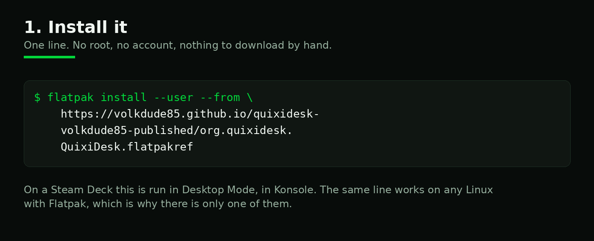
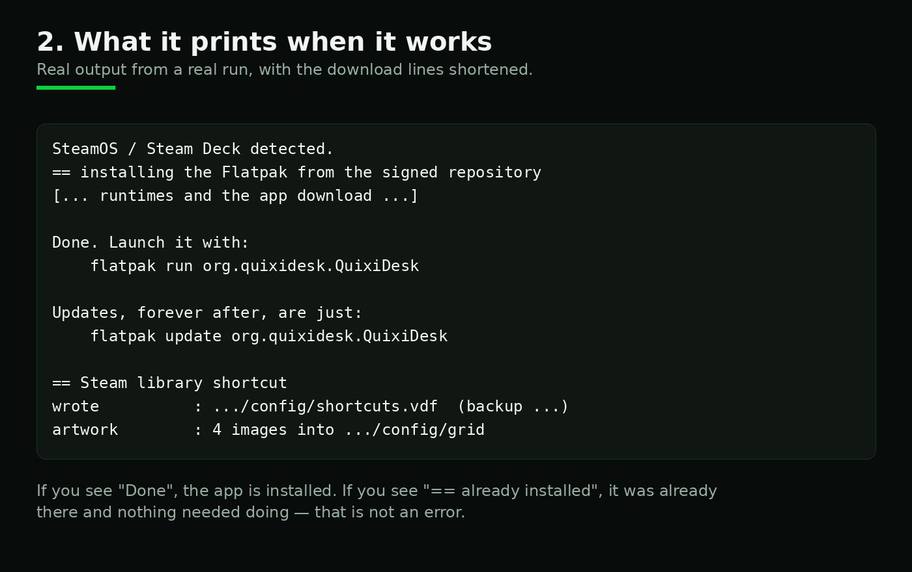
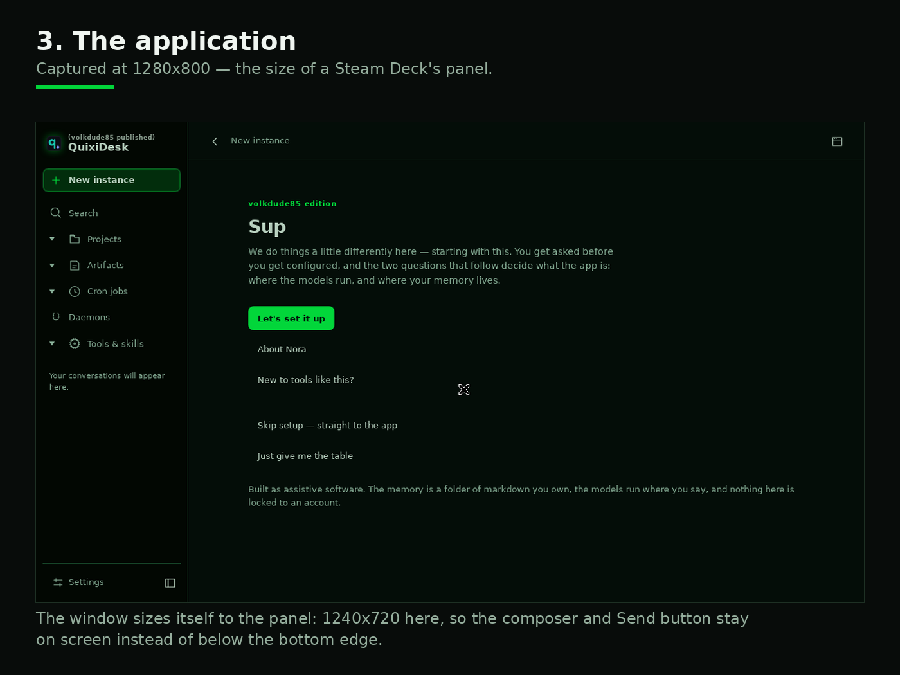
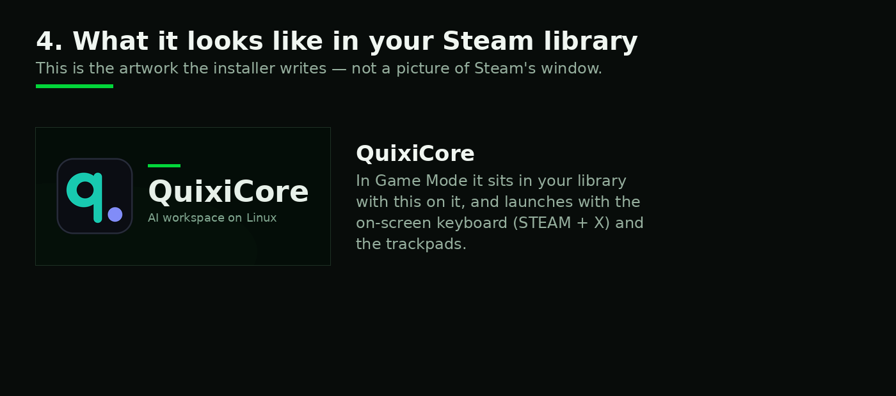
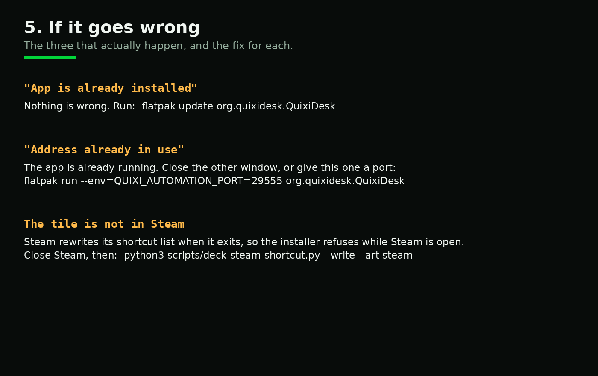

# Setting it up, in pictures

For anyone who would rather look than read a wall of text — and for anyone helping someone else set
this up over a shoulder or a phone call. Every panel below is either a capture of the real thing or a
rendering of the real output. Where it is a drawing instead of a capture, the caption says so.

---

## 1. Install it

One line, in Konsole, in Desktop Mode on a Deck. No root, no account. The same line works on any Linux
with Flatpak.

## 2. What it prints when it works

**"Done"** means installed. **"== already installed"** means it was already there — that is a success,
not an error. This is real output from a real run, with the download lines shortened.

## 3. The application

Captured at 1280x800 — a Steam Deck's panel. The window sizes itself to the screen, so the composer
and the Send button stay visible instead of falling below the bottom edge.

## 4. What it looks like in your library

The artwork the installer writes into Steam's shortcut. In Game Mode the app appears in your library
with this on it.

## 5. If it goes wrong

The three that actually happen. None of them is a broken install.

---

## Doing it without a keyboard

If typing the command is the hard part:

- **On a Deck**, in Desktop Mode, the on-screen keyboard is **STEAM + X**. The touchscreen works for
  the rest, and the trackpads drive the pointer.
- **From Game Mode**, the on-screen keyboard is the same chord, and a terminal is available by adding
  Konsole as a non-Steam shortcut — or by switching to Desktop Mode from the power menu.
- **Copy and paste** needs no terminal at all if someone else types the line for you: the command is a
  single URL-shaped line, and pasting it into Konsole and pressing Enter is the whole operation.
- **Everything after install** is a click: the app is in the application menu as *volkdude85's
  QuixiCore*, and in Game Mode once the shortcut is there.

## What this guide does not show

Steam's own windows. Capturing them means running Steam, and a drawing of somebody else's interface
presented as a screenshot would be a lie. So: the terminal panels are real output, the application
panel is a real capture, the tile is the real artwork — and the steps involving Steam's menus are
described in words in [`../STEAMDECK.md`](../STEAMDECK.md) instead of pictured.
